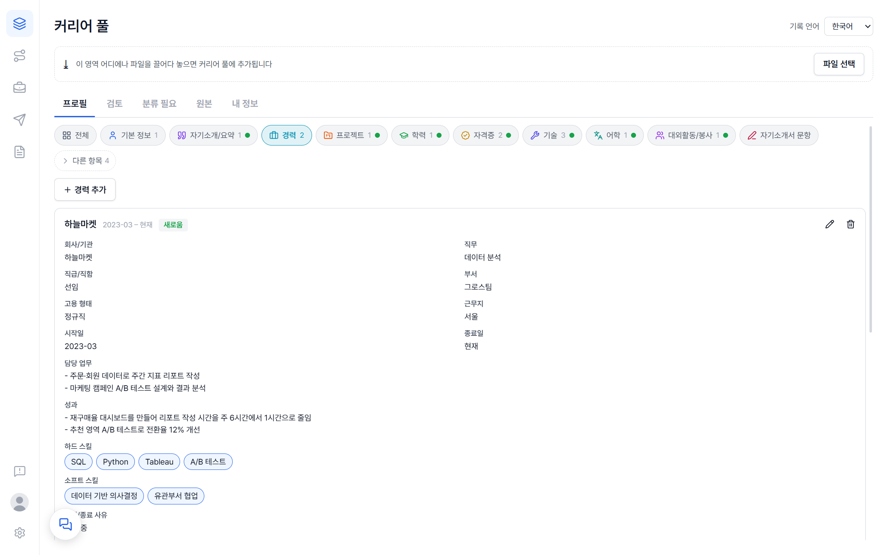
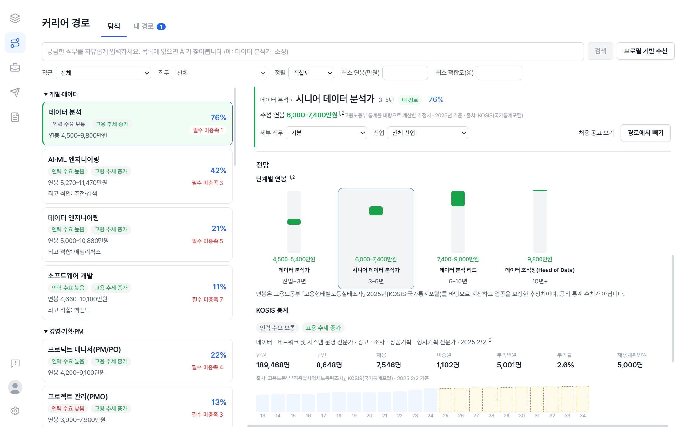
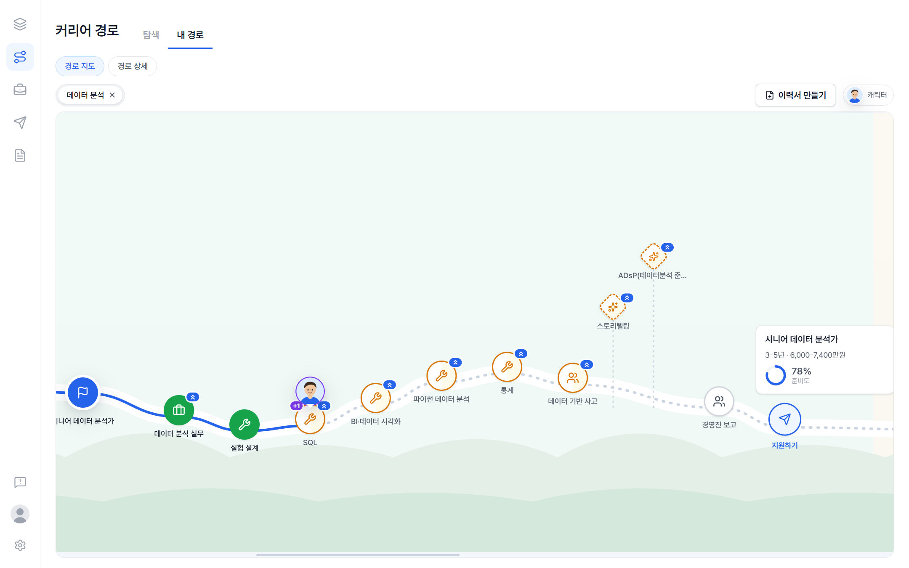
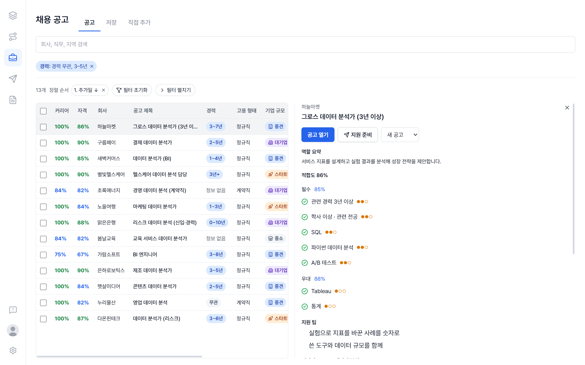
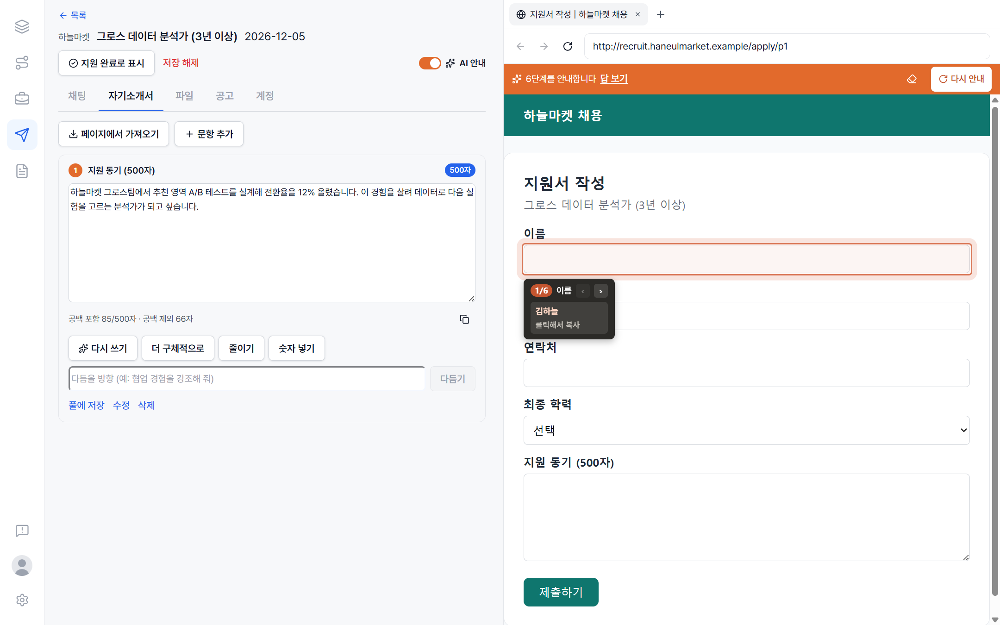
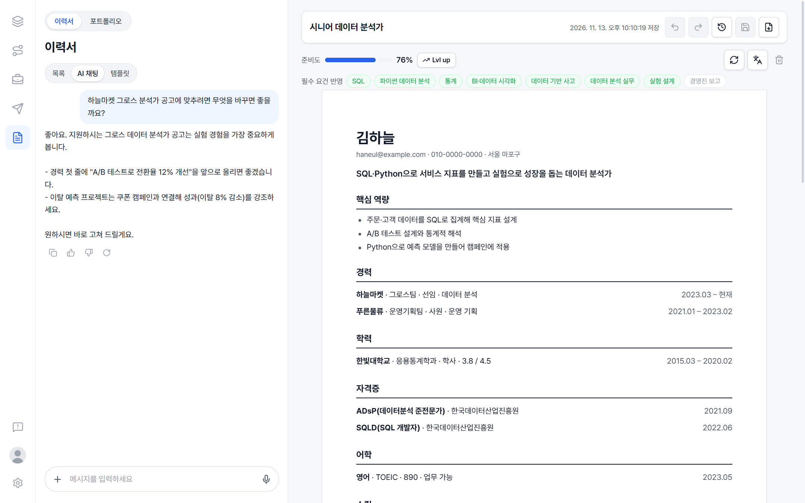
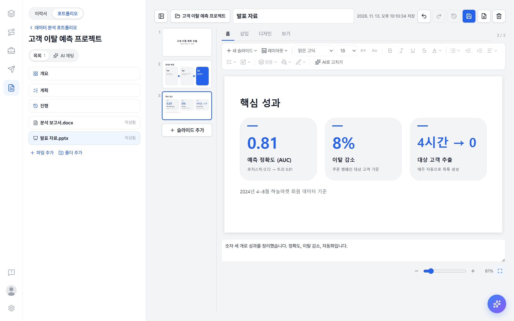
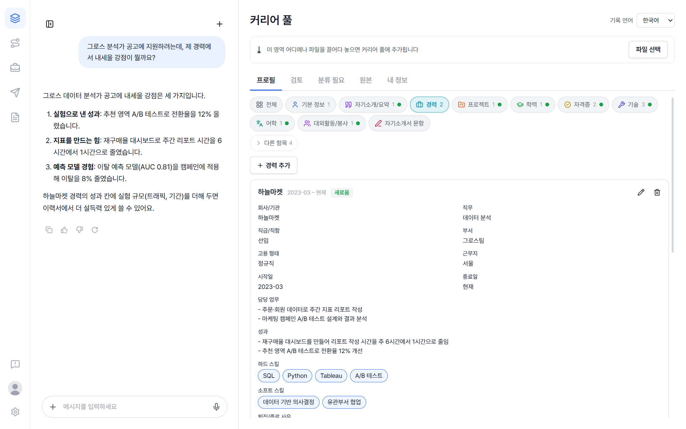

# Career Workspace

**구직의 전 과정을 돕는 AI 데스크톱 앱: 내가 가진 것을 정리하고, 갈 방향을 정하고, 공고를 찾고, 지원하기까지.**

[English](README.md) · [제품 결정](docs/product.ko.md) · [만든 방법](docs/how-it-was-built.ko.md) · [구조](docs/architecture.ko.md)

> 소스 코드는 비공개입니다. Career Workspace는 상용 제품으로 준비 중이라, 이 저장소는 앱이 하는 일, 그 뒤의 결정, 만든 방법을 보여 줍니다. 채용 검토를 위한 코드 열람은 요청하시면 가능합니다.

---

## 하는 일

Career Workspace는 한국 구직자를 위한 Windows 데스크톱 앱입니다. "예전 이력서와 메모가 여기저기 있다"에서 시작해 공고에 맞춘 지원서까지 한곳에서 이어 줍니다.

| | |
|---|---|
| **커리어 풀** | 예전 이력서, 자기소개서, 자격증, 프로젝트 메모, 포트폴리오를 형식 상관없이 넣으면 AI가 모든 사실을 정리된 프로필로 옮깁니다. 고쳐 쓰거나 순위를 매기지 않고 원래 자료 그대로 두기 때문에, 같은 풀에서 전혀 다른 이력서를 만들 수 있습니다. |
| **커리어 경로** | 약 27개 직무의 공용 라이브러리. 직무마다 단계별 요건, 연봉 추정, 공식 통계(KOSIS) 기반 전망이 있습니다. 내 프로필과의 적합도는 AI의 추측이 아니라 태그를 그대로 맞춰 본 결과입니다. 고른 경로는 다음 단계를 여는 조건이 보이는 스테이지 지도가 됩니다. |
| **채용 공고** | 수집을 허락한 곳에서 하루 한 번 모은 공용 공고 목록. 공고마다 두 점수를 내 컴퓨터에서 계산합니다: 커리어로 좋은 기회인지, 요건을 얼마나 갖췄는지. |
| **지원** | 공고 사이트 옆에 그 공고와 내 프로필을 아는 채팅이 열리고, 지원서 페이지마다 무엇을 채울지 한 단계씩 표시됩니다. 앱이 대신 입력하거나 제출하지 않으며, 로그인 페이지는 AI에 보내지 않습니다. |
| **이력서** | 목표 직무에 맞춘 이력서를 풀에서 작성합니다. 사실은 기록에서 그대로 가져오고, AI는 요약과 성과 문장만 쓰며, 모든 문장이 근거 기록을 밝힙니다. 노션식 편집, 저장본, 템플릿, 15개 언어, PDF 내보내기. |
| **포트폴리오** | 그 직무의 채용 담당자가 보는 포트폴리오 유형을 AI가 추천하고, 문서와 슬라이드로 된 폴더를 함께 한 단계씩 만들어 갑니다. |

## 화면

모든 화면은 지어낸 데이터로 찍었습니다.

| | |
|---|---|
|  |  |
|  |  |
|  |  |
|  |  |

## 제품이 지키는 원칙

- **AI는 제안하고, 결정은 사람이 합니다.** AI의 변경은 먼저 표시된 제안으로 보이고, 적용을 눌러야 반영됩니다.
- **AI는 본인의 기록에 묶여 있습니다.** 이력서 문장은 근거 기록을 밝혀야 하고, 근거가 없으면 빠집니다. 빈 곳을 채우려고 지어내지 않습니다.
- **기본이 개인정보 보호입니다.** 연락처, 비밀번호, 로그인 페이지는 AI에 보내지 않습니다. 저장한 사이트 계정은 컴퓨터 안에 암호화해 둡니다.
- **중요한 숫자는 늘 같습니다.** 직무 적합도와 공고 점수는 사용자 컴퓨터에서 하는 단순한 대조라서, 같은 프로필이면 언제나 같은 결과입니다.
- **출처를 존중합니다.** 공고는 약관이 허락하는 곳에서만 가져옵니다. Workday에서 운영되는 채용 사이트는 약관이 수집을 금지해 제외했습니다.

자세한 내용은 [docs/product.ko.md](docs/product.ko.md).

## 만든 방법: 솔직하게

**Career Workspace는 Claude Code(Anthropic의 AI 코딩 에이전트)를 주 개발자로 두고 만들었습니다. 코드는 거의 전부 Claude가 썼습니다.**

제가 한 일:
- **제품:** 무엇을, 누구를 위해, 왜 만들지.
- **기능마다 요구사항과 완료 기준.**
- **모든 설계와 절충 결정:** 개인정보 규칙, AI가 해도 되는 일과 안 되는 일, 쓸 수 있는 데이터 출처.
- **모든 변경을 실행 중인 앱에서 직접 테스트**한 뒤에 배포.
- **AI가 쓴 코드를 안전하게 내보내는 개발 흐름.**

| | |
|---|---|
| 기간 | 16일 (2026년 10월 28일 – 11월 12일), 진행 중 |
| 커밋 | 215개, 그중 171개가 Claude와 함께 쓴 것으로 표시됨 |
| 자동 테스트 | 153개 파일의 테스트 1,377개, 실제 앱을 조작하는 종단 간 테스트 9종 |
| 버전 | 11개 버전, 모두 제가 테스트하고 승인한 뒤 배포 |
| 코드 | TypeScript 약 14만 줄(테스트 제외), 제가 한 줄씩 직접 쓴 코드는 없음 |

AI가 내놓는 대로 받아들이는 의미의 "바이브 코딩"과는 다릅니다. 모든 기능은 글로 쓴 명세에서 시작하고, 모든 변경은 타입·린트·테스트를 통과하지 못하면 거부하는 병합 대기열을 거치며, 모든 버전은 테스트 채널에서 제가 확인하고 승인해야 배포됩니다. 앱에서 찾은 문제는 AI가 고치고 제가 승인하는 고침 작업이 됩니다.

자세한 내용은 [docs/how-it-was-built.ko.md](docs/how-it-was-built.ko.md).

## 사용한 기술

Electron · React · TypeScript · electron-vite · Vitest · Claude API (Opus, Sonnet, Haiku) · 사용자가 API 키를 다룰 필요가 없도록 직접 만든 작은 서버(Cloudflare Workers, Supabase 계정).

## 상태

개발 진행 중. 아직 내려받을 수 없습니다.

---

© 2026. All rights reserved. 이 저장소의 화면과 글은 허락 없이 다시 쓸 수 없습니다.
