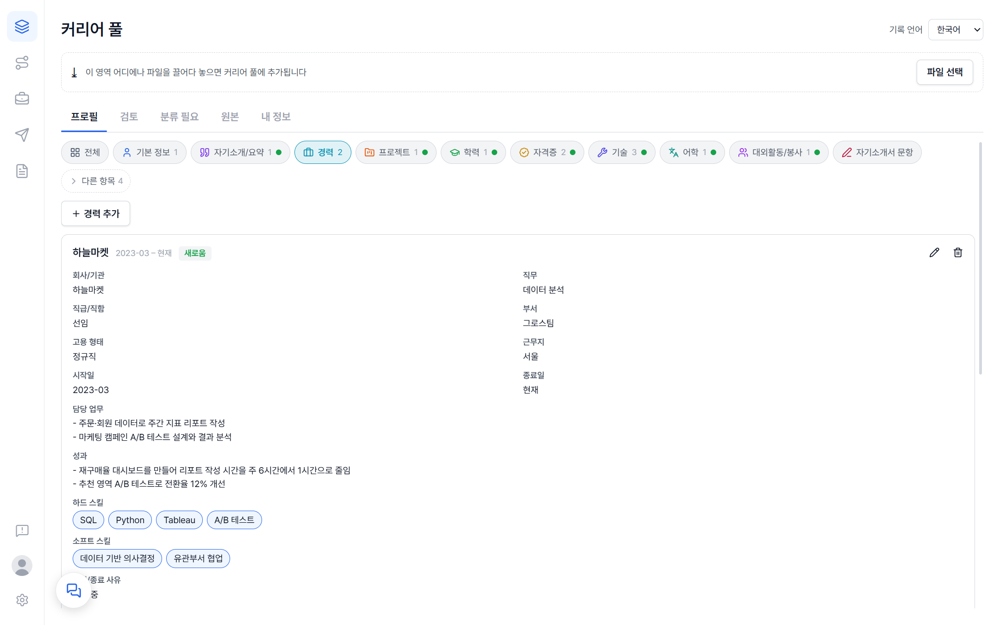
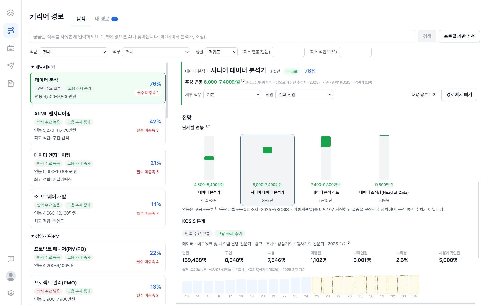
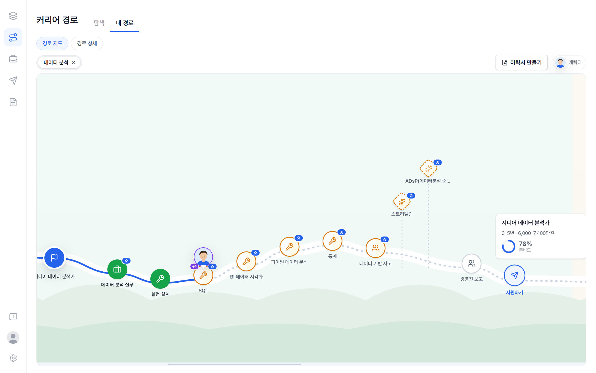
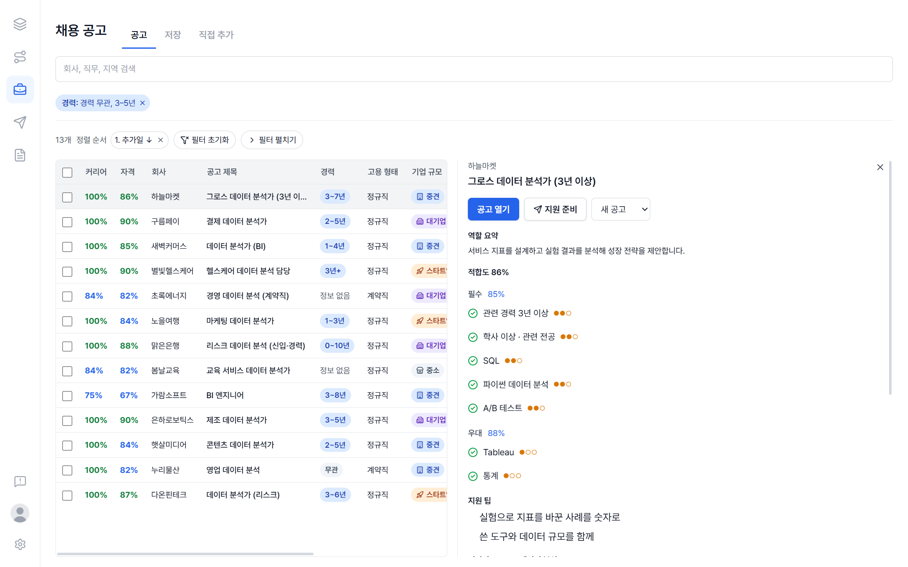
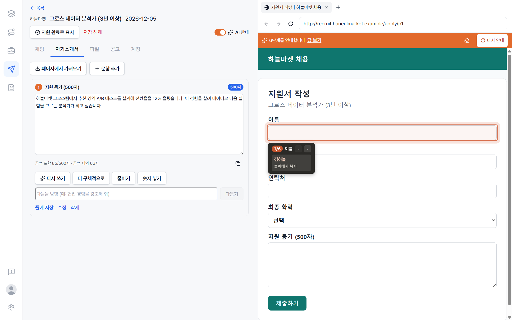
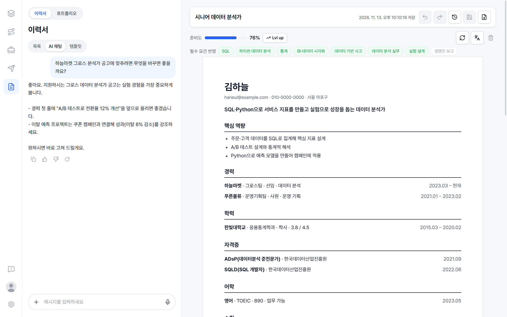
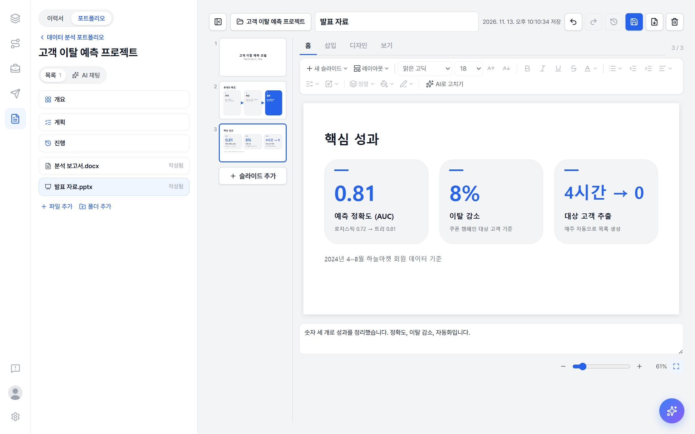
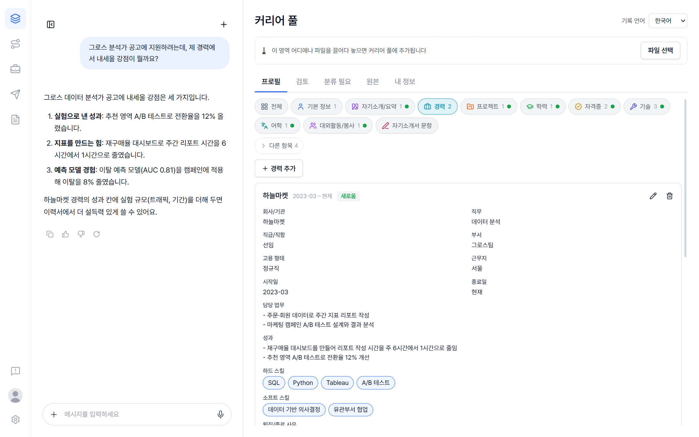

# Career Workspace

**An AI desktop app for the whole job search: knowing what you have, choosing where to go, finding postings, and applying.**

[한국어](README.ko.md) · [Product decisions](docs/product.md) · [How it was built](docs/how-it-was-built.md) · [Architecture](docs/architecture.md)

> The source code is private. Career Workspace is becoming a commercial product. This repository shows what it does, the decisions behind it, and how it was built. Code access for hiring purposes is available on request.

---

## What it does

Career Workspace is a Windows desktop app for Korean job seekers. It takes them from "I have a pile of old résumés and notes" to a tailored application, in one place.

| | |
|---|---|
| **커리어 풀 · Career pool** | Drop in old résumés, cover letters, certificates, project notes and portfolios in any format. AI sorts every fact into a structured profile. Nothing is rewritten or ranked: the pool keeps raw material, unbiased, so the same pool can produce very different résumés. |
| **커리어 경로 · Career paths** | A shared library of about 27 roles, each a ladder of stages with requirements, salary estimates and outlook from official statistics (KOSIS). The fit with your profile is plain tag matching, never a random AI guess. Your chosen paths become a stage map with what unlocks the next step. |
| **채용 공고 · Job postings** | One shared list of postings collected once a day from sources that allow it. Each posting gets two scores, worked out on your own computer: how good a career move it is, and how well you meet its requirements. |
| **지원 · Applying** | The posting's site opens beside a chat that knows the posting and your profile. Each page of the application form is marked step by step with what to fill in. The app never types or submits for you, and login pages are never sent to AI. |
| **이력서 · Résumés** | A résumé for a target role, written from the pool. Facts are copied from your records; AI writes only the summary and achievement lines, and every line cites the records it came from. Notion-style editing, versions, templates, 15 languages, PDF export. |
| **포트폴리오 · Portfolios** | AI suggests the kinds of portfolio a role's hiring managers look for, then builds a folder of documents and slides with you, step by step. |

## Screens

All screenshots use made-up data.

| | |
|---|---|
|  |  |
|  |  |
|  |  |
|  |  |

## Principles the product follows

- **AI proposes, the person decides.** AI changes are shown first, as marked proposals, and applied only on request.
- **AI stays bound to the person's own records.** Résumé lines must cite the records they come from; lines that don't are dropped. Nothing is invented to cover a gap.
- **Privacy by default.** Contact details, passwords and login pages never go to AI. Saved site logins are encrypted on the computer.
- **Deterministic where it matters.** Role fit and posting scores are plain matching on the user's computer, so the same profile always gives the same answer.
- **Respect for sources.** Job data comes only from sources whose terms allow it. Career sites hosted on Workday were dropped because its terms forbid collection.

More in [docs/product.md](docs/product.md).

## How it was built

**I built Career Workspace with Claude Code (Anthropic's AI coding agent) as the main implementer. Claude wrote almost all of the code.**

My part:
- **The product:** what to build, for whom and why.
- **The requirements and acceptance criteria** for every feature.
- **Every design and trade-off decision:** privacy rules, what AI may and may not do, which data sources are acceptable.
- **Testing every change myself** in the running app before it shipped.
- **The development workflow** that keeps AI-written code safe to ship.

| | |
|---|---|
| Time | 16 days (28 Oct – 12 Nov 2026), and continuing |
| Commits | 215, of which 171 are marked as co-written by Claude |
| Automated tests | 1,377 test cases in 153 files, plus 9 end-to-end suites that drive the real app |
| Versions | 11 released versions, each tested and approved by me before release |
| Code | about 140,000 lines of TypeScript (tests not counted), none of it written line by line by me |

It isn't "vibe coding" in the sense of accepting whatever the AI produces. Every feature starts from a written spec. Every change runs through a merge queue that refuses it if types, lint or tests fail. Every version goes to a test channel that I check and approve before release. Problems I find in the app become fix jobs that AI works on and I approve.

The details are in [docs/how-it-was-built.md](docs/how-it-was-built.md).

## Built with

Electron · React · TypeScript · electron-vite · Vitest · Claude API (Opus, Sonnet, Haiku) · a small server of my own on Cloudflare Workers with Supabase accounts, so users never handle an API key.

## Status

In active development. Not yet available for download.

---

© 2026. All rights reserved. The screenshots and text in this repository may not be reused without permission.
