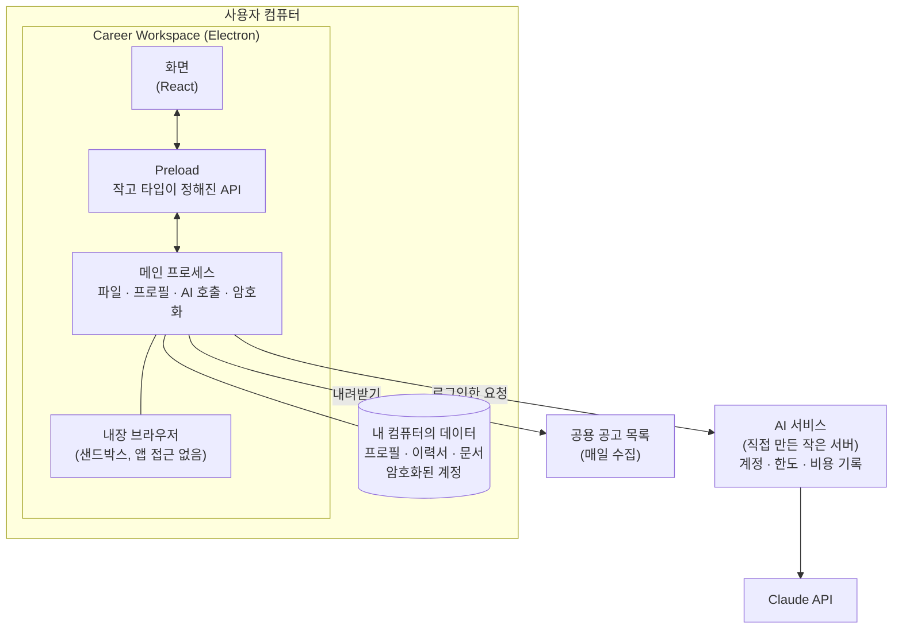

# 구조

[English](architecture.md) · [← README](../README.ko.md)

Career Workspace가 어떻게 짜여 있는지 한 장으로 정리했습니다. 코드 없이 시스템의 모양을 보고 싶은 분을 위한 글입니다.

## 구성

- **데스크톱 우선.** 전체 제품은 Windows 앱입니다. 사람의 커리어 데이터는 그 사람의 컴퓨터에 남습니다.
- **분리된 세 층**(Electron의 표준 구조를 엄격하게):
  - **화면**은 파일이나 네트워크에 직접 닿지 않습니다.
  - 화면은 작고, 이름이 정해진, 타입이 있는 API로만 **메인 프로세스**와 이야기합니다.
  - 권한이 필요한 일(파일, 프로필, AI 호출, 암호화)은 모두 **메인 프로세스**가 합니다.
- **내장 브라우저**(채용 사이트와 지원서용)는 완전한 샌드박스에서 돌고, 앱의 API에 접근할 수 없습니다. 페이지에서 읽은 것은 믿을 수 없는 데이터로 다룹니다.

## AI

- **일에 맞춰 고르는 세 가지 크기의 모델.** 글쓰기와 대화에는 가장 큰 모델, 많은 파일에서 사실을 뽑을 때는 중간 모델, 양식 페이지 안내나 번역처럼 싸고 잦은 일에는 가장 작은 모델.
- **직접 만든 서비스를 거쳐서.** 앱은 계정으로 로그인하고, AI 요청은 키를 가진 작은 서버를 거칩니다. 서버는 계정마다 하루·한 달 한도를 확인하고, 앱이 하지 않는 요청은 거부하며, 기능별 비용을 기록합니다. 무엇을 묻고 답했는지는 저장하지 않습니다.
- **믿을 수 없는 입력은 데이터로만.** 파일 내용과 웹 페이지에는 무엇이든 들어 있을 수 있어서, AI는 그것을 지시가 아닌 데이터로만 다루라는 규칙을 받습니다. 정확해야 하는 것(이력서의 사실, 연락처, 점수)은 AI가 아니라 코드가 다룹니다.

## 데이터와 개인정보

- 사람에 관한 모든 것은 그 컴퓨터에 저장됩니다: 원본 파일, 정리된 프로필, 이력서와 문서, 그 저장본까지.
- 지원에 쓰는 사이트 계정은 Windows의 사용자별 암호화로 보호합니다.
- **AI에 보내지 않는 것:** 연락처(번역에 필요할 때 이름만 예외), 비밀번호, 로그인과 본인 확인 페이지, 그리고 지원서를 쓸 때 다른 회사에 낸 자기소개서.

## 채용 공고

- 별도의 수집기가 하루 한 번, 수집을 허락한 곳만 읽고, 핵심 사실과 요건(스킬 ID)을 뽑아 공용 목록 하나를 냅니다.
- 앱은 그 목록을 내려받아, 공고마다 사용자의 프로필과 **그 사람의 컴퓨터에서** AI 없이 점수를 매깁니다.

## 품질과 배포

- 단위 테스트는 가짜 AI 클라이언트로 돌아갑니다: 네트워크도 비용도 없고 늘 같은 결과.
- 종단 간 테스트는 실제로 빌드한 앱을 화면 밖에서 가짜 AI 서버와 지어낸 데이터로 조작합니다.
- 변경은 타입, 린트, 관련 테스트를 돌리는 병합 대기열을 거쳐 하나씩 들어갑니다.
- 세 채널(개발 → 테스트 → 사용). 모든 배포는 사람이 승인하고, 되돌릴 수 있게 이전 설치 파일을 보관합니다.
- 버전마다 켜지는 속도, 반응 속도, 메모리 사용을 기록해 성능 저하가 버전별로 보입니다.

개발 흐름은 [how-it-was-built.ko.md](how-it-was-built.ko.md)에 더 있습니다.
