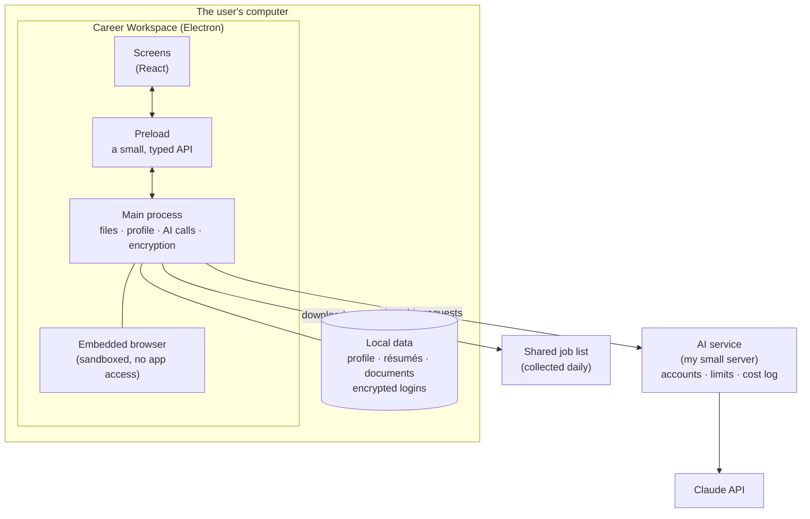

# Architecture

[한국어](architecture.ko.md) · [← README](../README.md)

A one-page overview of how Career Workspace is put together. It's for readers who want the shape of the system, without the code.

## The pieces

- **Desktop first.** The full product is a Windows app. People's career data stays on their own computer.
- **Three separated layers** (Electron's standard model, kept strict):
  - the **screens** never touch files or the network directly;
  - they talk to the **main process** only through a small, named, typed API;
  - the **main process** does everything privileged: files, the profile, AI calls and encryption.
- **The embedded browser** (for job sites and application forms) runs fully sandboxed, with no access to the app's API. What it reads from a page is treated as untrusted data.

## AI

- **Three model sizes, chosen per job.** The largest for writing and conversation, a mid-size model for extracting facts from many files at once, the smallest for cheap, frequent work like guiding a form page or translating.
- **Through my own service.** The app signs in to an account, and AI requests go through a small server that holds the key, checks each account's daily and monthly limits, refuses requests the app doesn't make, and logs cost per feature. It never stores what was asked or answered.
- **Untrusted input stays data.** File contents and web pages can contain anything, so the AI is told to treat them as data, never as instructions. Anything that must be exact (facts on a résumé, contact details, scores) is handled by code, not by AI.

## Data and privacy

- Everything about the person is stored locally: the raw files, the structured profile, résumés and documents with their saved versions.
- Site logins for applications are encrypted with Windows' own per-user encryption.
- **Never sent to AI:** contact details (except the name, when a translation needs it), passwords, login and identity-check pages, and other applications' essays when one is being written.

## Job postings

- A separate collector runs once a day, reads only sources that allow it, extracts the core facts and the requirements as skill IDs, and publishes one shared list.
- The app downloads that list and scores each posting against the person's profile **on their own computer**, without AI.

## Quality and releases

- Unit tests run with fake AI clients: no network, no cost, repeatable.
- End-to-end suites drive the real built app off-screen with a fake AI server and made-up data.
- Changes land one at a time through a merge queue that runs types, lint and the related tests.
- Three channels (development → test → in use), with every release approved by a person and older installers kept for rollback.
- Each version records how fast it starts and responds and how much memory it uses, so regressions are visible per version.

More on the workflow in [how-it-was-built.md](how-it-was-built.md).
