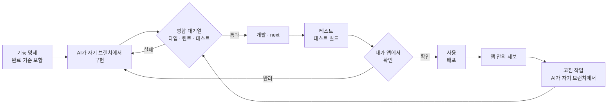

# 만든 방법

[English](how-it-was-built.md) · [← README](../README.ko.md)

Career Workspace는 한 사람이 AI 코딩 에이전트 Claude Code를 이끌어 만들었습니다. 이 프로젝트에서 가장 신경 써서 설계한 부분이 이 방식이라 따로 설명합니다.

## 누가 무엇을 했나

| | 나 | Claude Code |
|---|---|---|
| 무엇을 왜 만들지 | ✔ | 선택지를 제안 |
| 요구사항과 완료 기준 | ✔ | 불분명하면 질문 |
| 설계와 개인정보 결정 | ✔ 결정 | 제안하고 장단점 설명 |
| 코드 작성 | | ✔ 거의 전부 |
| 자동 테스트 | 규칙을 정함: 중요한 동작은 모두 테스트 | ✔ 작성 |
| 실행 중인 앱에서 테스트 | ✔ 모든 버전 | 자체 테스트 실행에서 화면을 찍음 |
| 배포 승인 | ✔ 나만 | |
| 아래의 개발 흐름 | ✔ 설계하고 다듬음 | ✔ 필요한 도구를 만듦 |

코드를 한 줄씩 쓰거나 검토하지는 않았습니다. 제가 설명할 수 있는 것은 앱이 어떻게 짜여 있고 왜 그렇게 동작하는지입니다: 구조, 데이터 흐름, 보안 규칙, 그리고 그 뒤의 결정들.

## 개발 흐름

### 1. 한 번에 한 기능, 명세에서 시작

매 주기는 기능 하나로 시작합니다: 끝나면 사용자가 무엇을 할 수 있는지, 그리고 완료 기준. AI가 지킬 규칙은 프로젝트 안에 있습니다: 기능을 처음부터 끝까지 완성하고, 막는 문제는 고치고, 그 밖의 것은 만들지 말고 백로그에 적고, 기능이 끝나면 **멈춘다**. 다음 기능으로 혼자 넘어가지 않습니다. 제품 동작, 비용, 보안, 데이터에 영향을 주는 결정은 제 몫이라 에이전트가 묻습니다.

### 2. 변경마다 자기 브랜치, 그리고 병합 대기열

여러 AI 세션이 동시에 일하는 경우가 많고, 각자 저장소의 복사본에서 자기 브랜치로 작업합니다. 끝난 변경은 제가 만들게 한 병합 대기열을 거쳐 개발 줄기(`next`)에 **하나씩** 들어갑니다:

- 변경을 최신 `next`와 합칩니다.
- 합친 결과에서 타입, 린트, 바뀐 파일과 관련된 단위 테스트를 돌립니다.
- 모두 통과해야만 `next`가 앞으로 갑니다.
- 겹치거나 실패한 변경은 이유와 함께 그 세션으로 돌아갑니다.

그래서 AI 세션끼리 서로의 작업을 망가뜨릴 수 없고, 검사받지 않은 것은 앱에 닿지 않습니다.

### 3. 세 채널: 개발 → 테스트 → 사용

- **개발:** 최신 `next`.
- **테스트:** 제 데이터의 복사본을 쓰는 별도 설치본. 넘길 때마다 무엇이 바뀌었고 어떻게 확인하는지가 변경별로 한국어로 적혀 옵니다.
- **사용:** 제가 실제로 쓰는 버전. 테스트한 빌드를 제가 승인해야만 바뀝니다. 이전 설치 파일을 보관해 되돌릴 수 있습니다.

테스트할 때는 제 말로 메모를 하나 쓰면, AI가 그것을 변경별로 **해결됨**, **부족함**, **달라야 함**으로 나눕니다. 맞지 않는 것은 그 변경을 만든 세션으로 돌아갑니다.

### 4. 이 모든 것을 다루는 운영 앱: 운영

배포 명령을 손으로 치고 싶지 않아서, 저만 쓰는 두 번째 데스크톱 앱 **운영**을 두었습니다:

- **버전:** 대기 중인 것, 테스트 중인 것, 사용 중인 것. 테스트로 보내기, 확인, 배포, 되돌리기, 그리고 모든 기록.
- **제보:** 앱 안에서 화면 사진과 함께 보낸 문제. AI가 비슷한 제보를 묶고, 버튼 하나로 고침 작업이 시작됩니다: Claude Code 세션이 자기 브랜치에서 고치고, 같은 대기열과 테스트 채널을 거쳐 돌아옵니다.
- **AI 사용:** 기능별, 날짜별 AI 비용.
- **시스템 상태:** 버전마다 앱이 얼마나 빨리 켜지고 반응하는지, 메모리를 얼마나 쓰는지. 느려지면 그날 바로 보입니다.
- **디자인:** 앱이 쓰는 모든 아이콘, 버튼 모양, 색. 새 화면이 새로 만들지 않고 다시 쓰게 합니다.

### 5. 거짓말하지 않는 테스트

- 단위 테스트는 진짜 AI를 부르지 않습니다. 가짜 클라이언트를 써서 비용 없이 빠르고 늘 같은 결과를 냅니다.
- 종단 간 테스트는 실제로 빌드한 앱을 화면 밖에서 켜고, 가짜 AI 서버와 지어낸 데이터로 직접 눌러 봅니다.
- 단위 테스트는 시간을 재지 않습니다. 컴퓨터가 바빴다는 이유만으로 시간 테스트가 테스트 빌드를 두 번 멈춘 적이 있어서, 속도는 따로 한 파일씩 잽니다.

## 배운 것

- **병목이 명세와 확인으로 옮겨 갑니다.** AI는 코드를 빨리 씁니다. 제품의 질은 "끝났다"를 얼마나 분명히 적고, 얼마나 꼼꼼히 확인하느냐에 달려 있습니다.
- **좋은 의도보다 안전장치가 낫습니다.** "테스트를 돌려 주세요"보다, 테스트가 실패하면 변경을 거부하는 대기열이 강합니다.
- **작고 분리된 변경이 여러 AI 세션의 충돌을 막습니다.** 변경마다 브랜치 하나, 한 번에 하나씩 넣기로 한 가지 종류의 고장이 통째로 사라졌습니다.
- **AI 비용은 처음부터 정직하게 세야 합니다.** AI 호출을 기능별로 세기 때문에, 어디에 더 싼 모델이면 충분한지 정할 수 있습니다.
- **하지 않은 일을 분명히 말하는 것이 중요합니다.** 시스템과 그 안의 모든 결정은 설명할 수 있습니다. 코드를 제가 썼다고는 말할 수 없습니다.
