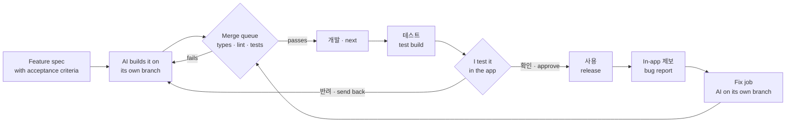

# How it was built

[한국어](how-it-was-built.ko.md) · [← README](../README.md)

Career Workspace was built by one person directing an AI coding agent, Claude Code. This page explains the setup, because it's the part of the project I designed most deliberately.

## Who did what

| | Me | Claude Code |
|---|---|---|
| What to build and why | ✔ | suggests options |
| Requirements and acceptance criteria | ✔ | asks when something is unclear |
| Design and privacy decisions | ✔ decides | proposes, explains trade-offs |
| Writing the code | | ✔ almost all of it |
| Automated tests | sets the rule: every significant behaviour is tested | ✔ writes them |
| Testing in the running app | ✔ every version | takes screenshots in its own test runs |
| Approving a release | ✔ only me | |
| The development workflow below | ✔ designed and refined it | ✔ built the tools for it |

I didn't write or review the code line by line. What I can explain is how the app is put together and why it behaves as it does: the architecture, the data flows, the security rules and the decisions behind them.

## The workflow

### 1. One feature at a time, from a spec

Every cycle starts with one feature: what the user can do afterwards, with acceptance criteria. The rules for the AI live in the project: build the whole feature end to end, fix what blocks it, record anything else in a backlog instead of building it, and **stop** when the feature is done. It never moves on to the next feature by itself. Decisions that affect product behaviour, cost, security or data are mine, and the agent asks.

### 2. Every change on its own branch, through a merge queue

Several AI sessions often work at once, each in its own copy of the repository on its own branch. Finished changes join the main development line (`next`) **one at a time** through a merge queue I had built:

- the change is merged with the latest `next`;
- types, lint and the unit tests related to the changed files are run on the result;
- only if everything passes does `next` move forward;
- a change that conflicts or fails goes back to its session with the reason.

So no two AI sessions can break each other's work, and nothing unchecked reaches the app.

### 3. Three channels: 개발 → 테스트 → 사용

- **개발 (development):** the latest `next`.
- **테스트 (test):** a separate installed build with its own copy of my data. Each handover lists, in Korean, exactly what changed and how to check it, change by change.
- **사용 (in use):** the version I actually use. It moves only when I approve a tested build. Older installers are kept, so I can roll back.

When I test a build, I write one note in my own words. AI reads it and sorts it per change: **해결됨** (works), **부족함** (not enough) or **달라야 함** (should be different). What's not right goes back to the session that made it.

### 4. An owner app to run all of this: 운영

I didn't want to run release commands by hand, so the project has a second desktop app just for me, **운영** (operations):

- **버전:** what's waiting, in test and in use; send to test, approve, release, roll back, with a history of everything.
- **제보 (reports):** problems sent from inside the app with a screenshot. AI groups similar reports, and one button starts a fix job: a Claude Code session on its own branch that fixes it and comes back through the same queue and test channel.
- **AI 사용:** what AI costs, per feature and per day.
- **시스템 상태:** how fast the app starts and responds, and how much memory it uses, per version, so a slowdown shows up the day it appears.
- **디자인:** every icon, button style and colour the app uses, so new screens reuse them instead of inventing new ones.

### 5. Tests that don't lie

- Unit tests never call real AI. They use fake clients, so they're free, fast and repeatable.
- End-to-end suites start the real built app off-screen, with a fake AI server and made-up data, and click through it.
- Unit tests never assert timing. A timing test twice stopped a test build only because the computer was busy. Speed is measured separately, one file at a time.

## What I learned

- **The bottleneck moves to specification and checking.** AI writes code fast. The quality of the product depends on how clearly I describe what "done" means and how carefully I test.
- **Guardrails beat good intentions.** "Please run the tests" is weaker than a queue that refuses a change when tests fail.
- **Small, separate changes keep many AI sessions from colliding.** One branch per change and one landing at a time removed a whole class of breakages.
- **Honest numbers about AI cost need to be built in.** Every AI call is counted per feature, so I can decide where a cheaper model is good enough.
- **Being clear about what I didn't do matters.** I can explain the system and every decision in it. I can't claim to have written the code.
